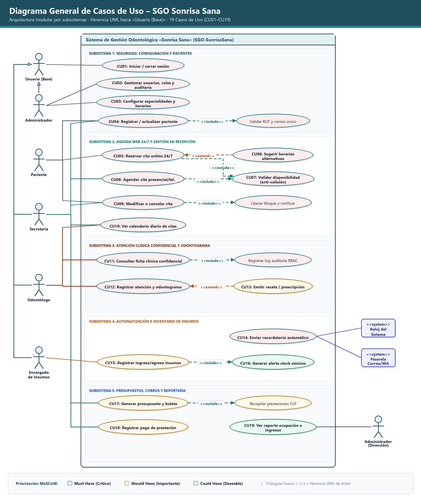
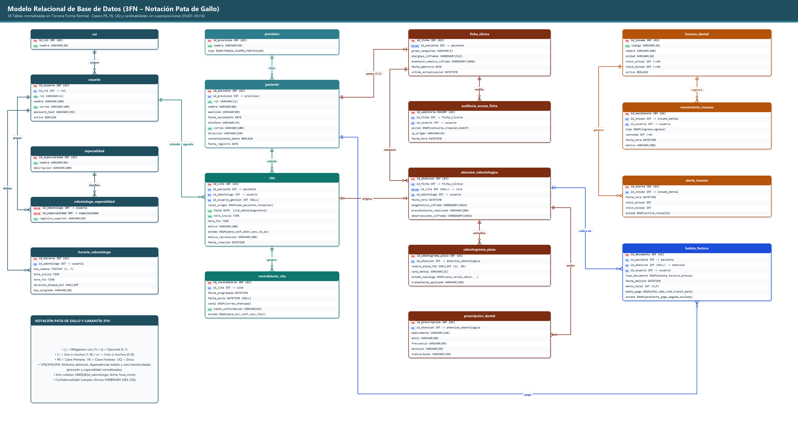
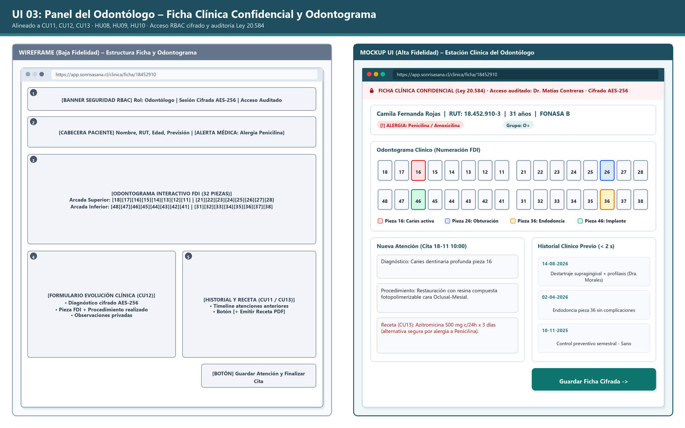
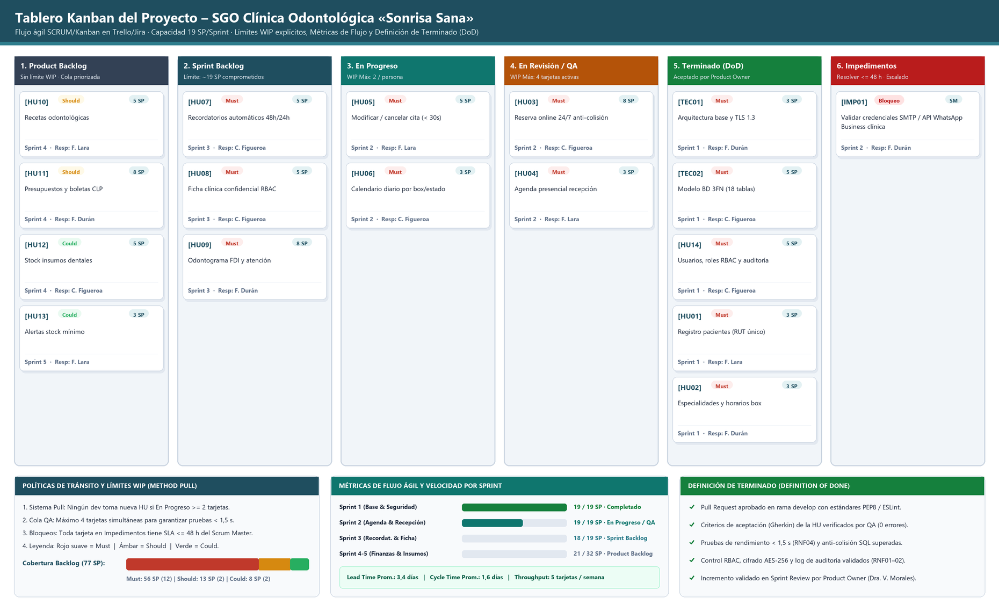

# Sistema de Gestión Odontológica — Clínica «Sonrisa Sana» (`SGO-SonrisaSana`)

Repositorio oficial del proyecto de **Evaluación Sumativa N° 5 (Prueba N° 1 – Unidad 1, 20%)** de la asignatura **Modelamiento de Soluciones Informáticas** en **INACAP** (Sección `114-2-F2`).

- **Docente:** Yaleni Gómez Peña
- **Integrantes del Equipo:**
  - **Christopher D. Figueroa Arthur** — Líder Técnico / Backend, Base de Datos & QA
  - **Fernando A. Durán Leiva** — Scrum Master / Base de Datos
  - **Francisco A. Lara Yévenes** — Analista Funcional / UX & Diagramación
- **Estándar aplicado:** Pauta oficial de evaluación (`60 / 60 puntos`, `60%` exigencia) + Plantilla completa de referencia docente [`Huellitas_Proyecto_SCRUM (Com_28102026).xlsx`](./01_Pauta_y_Referencia/Huellitas_Proyecto_SCRUM%20(Com_28102026).xlsx).

---

## 📂 Estructura Definitiva del Repositorio

```text
INACAP-Sonrisa-Sana/
├── README.md
├── 01_Pauta_y_Referencia/
│   ├── 1 - Evaluación Sumativa 5 - Descripción.docx
│   ├── 2 - Evaluación Sumativa 5 - Instrucciones.pdf
│   ├── 3 - Evaluación Sumativa 5 - Rubrica.docx
│   └── Huellitas_Proyecto_SCRUM (Com_28102026).xlsx
├── 02_Entregables_Sonrisa_Sana/
│   ├── SonrisaSana_Proyecto_SCRUM.xlsx                  # Libro SCRUM completo (18 hojas + fórmulas + 19 diagramas)
│   ├── Informe_Evaluacion_Sumativa_5_Sonrisa_Sana.docx  # Informe técnico formal integral (22 tablas, 19 figuras)
│   ├── sonrisa_sana_bd.sql                              # Script físico MySQL 8.0 InnoDB en 3FN (18 tablas)
│   └── Diagramas_SonrisaSana/                           # 19 diagramas PNG de alta resolución (2x LANCZOS)
└── 03_Guia_Paso_a_Paso_y_Defensa/
    ├── GUIA_MAESTRA_PASO_A_PASO_Y_CONCEPTOS.md          # Manual de estudio desde cero + Paso a Paso + Defensa
    └── Guia_Maestra_Paso_a_Paso_y_Defensa_Sonrisa_Sana.docx
```

---

## 📖 ¿Por dónde empezar para estudiar y defender el proyecto?

Si quieres comprender desde cero cada concepto técnico (**RF vs. RNF ISO/IEC 25010, MoSCoW, Historias de Usuario, Story Points, Casos de Uso `<<include>>`/`<<extend>>`, Tercera Forma Normal 3FN, Pata de Gallo, Triggers, Flujos TO-BE, Odontograma FDI y Tablero Kanban WIP**) y revisar el **guion de defensa oral con 12 preguntas típicas de la docente**, abre directamente:

- 📘 **[Guía Maestra Paso a Paso y Conceptos (Markdown)](./03_Guia_Paso_a_Paso_y_Defensa/GUIA_MAESTRA_PASO_A_PASO_Y_CONCEPTOS.md)**
- 📄 **[Guía Maestra Paso a Paso y Defensa (Word `.docx`)](./03_Guia_Paso_a_Paso_y_Defensa/Guia_Maestra_Paso_a_Paso_y_Defensa_Sonrisa_Sana.docx)**

---

## 🎯 Cobertura Completa de la Rúbrica Oficial (`60 / 60 puntos`)

| Criterio INACAP | Indicadores Cubiertos en Esta Solución | Artefacto Principal |
| :--- | :--- | :--- |
| **1.1.1 Toma de Requerimientos** (`8,4 pts`) | Análisis AS-IS vs. TO-BE del cuaderno físico; **18 RF** (`10 Must, 2 Should, 2 Could, 4 Won't`) y **13 RNF** bajo norma **ISO/IEC 25010** con métricas verificables (`< 1,5 s P95`, `AES-256`, `bcrypt`, `RBAC`, Leyes `20.584` y `19.628`). | [`SonrisaSana_Proyecto_SCRUM.xlsx`](./02_Entregables_Sonrisa_Sana/SonrisaSana_Proyecto_SCRUM.xlsx) (Hojas `Acta Proyecto`, `Req Funcionales`, `Req No Funcionales`) |
| **1.1.2 Análisis de Resultados** (`8,4 pts`) | Estudio de factibilidad (técnica, operativa, económica, legal), matriz dinámica `Resumen MoSCoW` (`=COUNTIF`), **14 Historias de Usuario** (`69 SP`) y **Product Backlog** (`77 SP` en 5 Sprints con `=SUMIF`). | Hojas `Resumen MoSCoW`, `Historias Usuario`, `Product Backlog` |
| **1.1.3 Casos de Uso y Wireframes** (`14,4 pts`) | Catálogo de **19 Casos de Uso (`CU01`–`CU19`)** con herencia UML, `<<include>>` y `<<extend>>`; **6 diagramas UML** (General + 5 módulos); **7 fichas de especificación** completas; y **4 láminas Wireframe + Mockup UI** (incluyendo **Odontograma FDI de 32 piezas**). | Hojas `Casos de Uso`, `Especificación CU`, `Wireframes y Mockups` + PNGs [`01`–`06`](./02_Entregables_Sonrisa_Sana/Diagramas_SonrisaSana) y [`15`–`18`](./02_Entregables_Sonrisa_Sana/Diagramas_SonrisaSana) |
| **1.1.4 Base de Datos en 3 Niveles** (`9,6 pts`) | Esquema en **3 niveles completos**: **1) Lógico** (18 entidades en 4 dominios), **2) Relacional 3FN** (notación Pata de Gallo), **3) Físico DDL MySQL 8.0** + Diccionario de Datos exhaustivo (**18 tablas, 118 columnas**), **4 Triggers**, **4 Vistas** y **1 Evento Cron horario**. | Hojas `Modelo BD`, `Diccionario Datos` + [`sonrisa_sana_bd.sql`](./02_Entregables_Sonrisa_Sana/sonrisa_sana_bd.sql) + PNGs `07`–`09` |
| **1.1.5 Diagramas de Flujo TO-BE** (`9,6 pts`) | **5 diagramas de flujo TO-BE** con bandas de fase, insignias numeradas y manejo de excepciones: Reserva Online, Modificación/Cancelación (`< 30 s`), Atención Confidencial RBAC/AES-256, Recordatorios Automáticos y Presupuestos/Insumos. | Hoja `Diagramas Flujo` + PNGs `10`–`14` |
| **1.1.6 Informe y Tablero Kanban** (`9,6 pts`) | Informe técnico integral (`6 944` palabras), Roles SCRUM + Matriz RACI, **39 tareas (`T01`–`T39`)** con fechas hábiles en Chile (`=WORKDAY`/`=NETWORKDAYS`), Carta Gantt de 13 semanas y **Tablero Kanban con límites WIP**, DoD y métricas de flujo. | [`Informe_Evaluacion_Sumativa_5_Sonrisa_Sana.docx`](./02_Entregables_Sonrisa_Sana/Informe_Evaluacion_Sumativa_5_Sonrisa_Sana.docx) + Hoja `Tablero Kanban` + PNG `19` |

---

## 🖼️ Vista Rápida de los Diagramas Principales (`Diagramas_SonrisaSana/`)

### Casos de Uso UML General (`CU01`–`CU19`)


### Modelo Relacional 3FN (`18` Tablas — Notación Pata de Gallo)


### Wireframe + Mockup Estación Odontólogo y Odontograma FDI


### Tablero Kanban, Límites WIP y Métricas Ágiles

